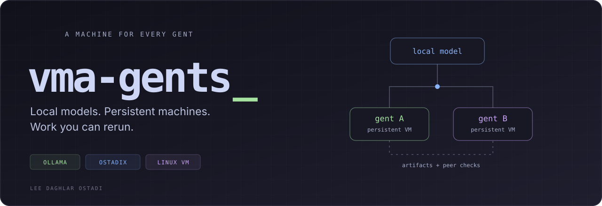
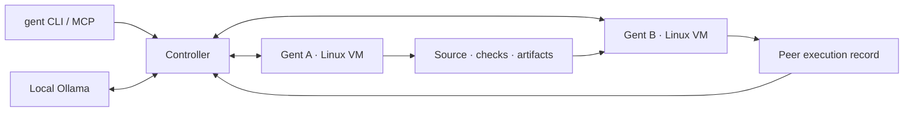

<p align="center">
  
</p>

<p align="center">
  <a href="#run-it">Run it</a> ·
  <a href="#how-it-works">How it works</a> ·
  <a href="docs/command-reference.md">Commands</a> ·
  <a href="docs/ostadix-agent-control.md">Ostadix</a> ·
  <a href="LICENSE">ISC</a>
</p>

<p align="center">

[](https://m8ven.ai/mcp/lostadi-vma-gents-b8o63h?s=readme)

</p>

**An agent with a VM of its own. Each one is a gent.**

I want a local agent to have somewhere to work: a machine, files that survive
the conversation, and a way to run what it writes. If another agent checks its
work, that agent should be able to execute it and inspect the result.

vma-gents gives local agents persistent Linux environments. A gent can write
programs, run them, keep its state, and pick up where it stopped. Several gents
can exchange actual artifacts and rerun each other's work in separate VMs.
[Ostadix](https://github.com/lostadi/OSTADIX) provides structured polyglot
execution with retained source, checks, and execution records.

The point is to give small local models a useful working environment. Better
tools and feedback are worth building. How far a given model can take them is
something to measure.

| | What a gent gets |
| :--- | :--- |
| **A machine** | A private, persistent ARM64 Linux filesystem, with Apple Virtualization or QEMU running the guest. |
| **Local inference** | Ollama on the initiating host. Choose an installed model with `--model NAME`. |
| **Executable work** | Shell commands and structured `.O` programs, with captured results. |
| **Another pair of hands** | Peer messages, shared artifacts, and a distinct gent that can rerun the original source and checks. |
| **Continuity** | Saved history and disks; resume, clone, export, or import the environment. |

## Run it

**Fresh guest setup requires Apple Silicon, macOS 14+, Node.js 26+, npm,
and a running Ollama server with its CLI on PATH.** It also requires compatible
local Claude Desktop VM inputs, as listed in the
[compatibility profile](compatibility/claude-desktop.json). Those private disks
and helper images are obtained locally; they are not included in this repository.

```sh
git clone https://github.com/lostadi/vma-gents.git
cd vma-gents

./setup.sh --help
./setup.sh
./bin/gent check
./bin/gent chat --local
```

Setup installs the application dependencies and default model, prepares the
guest's Ostadix environment and language runtimes, and installs the `gent`
shortcut in `~/.local/bin`. The first guest build can take tens of minutes.
Node and Ollama must already be installed. If the shortcut is not on your PATH,
keep using `./bin/gent` from the checkout.

For nonstandard private input locations, set `CLAUDE_VM_SOURCE_BUNDLE` and
`CLAUDE_VM_SMOL_SOURCE` before setup. An incompatible helper is rejected; see
the [setup guide](docs/getting-started.md) for the accepted inputs and recovery
paths. The JavaScript runs directly under Node; there is no compilation step.

To inspect a task plan before provisioning a guest:

```sh
npm ci
./bin/gent task "Run uname -m and report the observed result" --local --dry-run
```

`--dry-run` inspects the plan and prerequisites without calling the model or
booting a VM. `gent check` is also a prerequisite check, not a live execution test.

## Give it work

```sh
gent chat --local
gent task "Write a Python parser, run its tests, and show the results" --local
gent task "Build a parser and have another gent check it" --agents 3 --local
```

Chat keeps the same VM and conversation between messages. `/status` shows the
saved ID, `/help` lists the controls, and `/bye` exits. A quoted message runs one
turn; `--text` selects conversation without VM execution.

```sh
gent chat "Read the files we created and continue the work" --resume GENT_ID --local
gent chat --text "Explain this idea"
gent list
gent show GENT_ID
gent resume GENT_ID --rounds 8 --local
```

A task starts one gent with room for a second to review its work. `--agents 3`
starts three and sets the cap to three; `--max-agents N` sets a different cap.
Tasks default to four reasoning rounds. Hitting the round limit saves the work
without declaring it complete.

The default model is `huihui-spark-vm:32k`, built from the local
Huihui-Spark-X2.5-4B Q4_K_M weights. The alias defaults to 32K context; swarm
requests use 8K unless `OVM_SWARM_CONTEXT` is set. The running Ollama server must
support the model architecture.

## How it works



Inference runs on the initiating host. Programs run inside each gent's VM on
the selected controller. Task VMs default to one vCPU and 768 MiB RAM each;
model memory is additional. The controller retains history, observations,
artifacts, and the evidence used to decide whether work is complete.

### Let another gent run it

A structured Ostadix run retains the submitted `.O` source and its original
output checks. Native inspection binds execution to that source and its
execution intent. A different gent can then read the record and rerun the same
program and checks in its own VM.

| Recorded state | What happened |
| :--- | :--- |
| `static-check-passed` | Native parsing and intent inspection passed. The program has not run; skipped backend checks remain unchecked. |
| `checks-passed` | Execution succeeded and all declared output checks passed. |
| `peer-verified` | A different gent reran the same source and checks in a separate VM, and they passed. |

The reviewer cannot replace the source, weaken the checks, or review its own
work. A later failed review blocks completion again.

```sh
gent swarm --spec examples/ostadix-peer-review.json --local --dry-run
gent swarm --spec examples/ostadix-peer-review.json --local
```

The second command uses real VMs and Ollama. It is a model-driven task and may
need more rounds or correction. Ordinary shell exploration and chat do not
automatically receive these peer checks. A passing check establishes what it
tests; two gents can still share the same mistaken assumption.

### Keep the environment

```sh
gent clone GENT_ID my-copy
gent export GENT_ID ~/my-gent.ovm
gent import ~/my-gent.ovm my-imported-gent
gent resume my-imported-gent --local
```

Stop active work before cloning or exporting. A `.ovm` capsule carries saved
history, stopped guest disks, matching boot inputs, and full model weights.
The receiving host still needs vma-gents, a compatible Ollama server, and a
supported VM engine. These archives contain private guest data and boot inputs;
keep them private. See the [capsule format](docs/agent-capsule-format.md).

### Choose where it runs

Apple Virtualization is the default on Apple Silicon. Task/chat also support
QEMU on Linux and macOS with a prepared ARM64 guest or an imported capsule.
Fresh guest provisioning is currently Apple-only. QEMU needs
`qemu-system-aarch64`, `mke2fs`, `python3`, and `lsof`; cross-architecture execution
uses slower software emulation.

```sh
gent check --backend qemu
gent chat --backend qemu --local
gent peers
gent connect USER@HOST --name second-host
gent task "Run the tests and report their output" --on second-host
```

`--local` keeps VM execution on this machine and retains internet access.
`--isolated` disables guest networking. Automatic placement can use compatible
connected controllers when local capacity is low. A communicating family stays
on one controller; independent families can use different hosts. Explicit
`--on NAME` fails if that destination is unavailable.

Remote enrollment requires a prepared host and trusted SSH access, and shares
network signing authority. See [networking](docs/networking.md) before connecting
controllers.

## Inside the repository

| Path | Purpose |
| :--- | :--- |
| [`src/`](src/) · [`bin/`](bin/) | CLI, controller, Ollama client, persistence, and VM adapters. |
| [`host/`](host/) · [`prebuilt/`](prebuilt/) | Swift runners, QEMU helpers, entitlements, and checksummed Apple Silicon launchers. |
| [`guest/`](guest/) | Guest provisioning, networking, and runtime integration. |
| [`integrations/`](integrations/) | Ostadix and OpenCode/MCP entrypoints. |
| [`examples/`](examples/) · [`test/`](test/) | Task specifications, programs, and automated checks. |

The [research browser source](src/research-browser.mjs) and
[host web search](docs/agent-pockets.md#host-web-search) are included.
Private VM images, model weights, saved gents,
credentials, and private native add-ons stay outside Git. This repository alone
is not a complete bootable guest.

`gent` is the main CLI. The earlier `o-gents` name appears in historical records
and internal labels; `ovm`, `OVM_*`, and `.ovm` remain compatible interfaces.
For an MCP client, use `bin/claude-vm-mcp` directly. The Apple-only diagnostic
runner has its own [resource and readiness rules](docs/apple-mcp-runner.md).

## Read further

- [Getting started](docs/getting-started.md) — setup, guest tools, and daily use.
- [Command reference](docs/command-reference.md) — commands, flags, and aliases.
- [Ostadix actions and peer review](docs/ostadix-agent-control.md) — source, intent, evidence, and completion contracts.
- [Gents and persistent VM pockets](docs/agent-pockets.md) — controller architecture and action protocol.
- [Publication verification, November 6, 2026](docs/publication-verification-2026-11-06.md) — checks performed for this repository snapshot.
- [Manual verification, October 4, 2026](docs/manual-verification-2026-10-04.md) · [Setup verification, October 5, 2026](docs/setup-verification-2026-10-05.md) — earlier observations, with their original scope and limits.

---

Built by **[Lee Daghlar Ostadi](https://leeostadi.com)**. Released under the
[ISC license](LICENSE).
